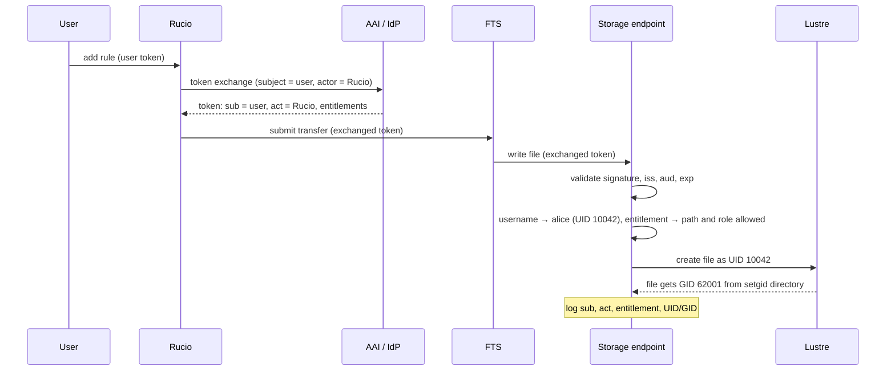
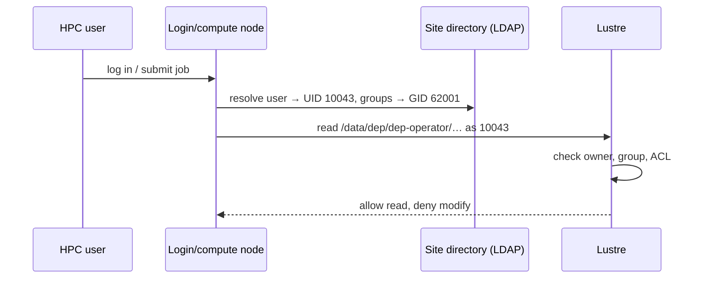

# Identity mapping on HPC storage

Concept behind [ADR-007](../adrs/adr-007-identity-mapping-on-hpc-storage.md).
Forward-looking: token exchange in Rucio is not available yet; until then
transfers run under Rucio's own identity (see "Interim" below).

Hard constraint: **user context is preserved end to end** and access is
fine-grained. Tokens carry *who* (user), *which groups and roles*
(entitlements) and *what executed it* (actor). POSIX storage like Lustre only
knows **numeric UIDs/GIDs**, so the storage endpoint maps the token to a
local user before any file is touched; the project group comes from the
directory the file is written to.

## Three questions, three claims

| Question | Claim | On storage | Used for |
| --- | --- | --- | --- |
| **Who** asked? | `sub` + username claim | file owner (UID) | attribution, quota, audit |
| **May** they access this? | `entitlements` (group, role) | endpoint path rules; project GID via setgid directory | authorization |
| **What** executed it? | `act` | endpoint log only | chain of custody |

Access is decided **per group**, attribution is kept **per user**. Rucio
keeps one replica of a DID per RSE, and the project group lets every member
read it, so data registered once is stored once. Duplicates only arise when
the same content gets a second DID (see "One copy" below).

## What each layer looks like

**Token** after Rucio's token exchange (RFC 8693), decoded payload:

```json
{
  "iss": "https://aai.example.org/",
  "sub": "7f3c2a1e-…",
  "preferred_username": "alice",
  "act": { "sub": "rucio-dep" },
  "aud": "https://dep-storage1.example:1094",
  "scope": "storage.read:/dep-operator storage.modify:/dep-operator",
  "entitlements": [
    "urn:example:aai.example.org:group:dep-operator:role=member"
  ],
  "exp": 1791205768
}
```

`sub` is opaque, so mapping to a site account uses a **stable, unique
username claim**. Entitlements follow the AARC-G002 pattern
`<namespace>:group:<group>[:<subgroup>]:role=<role>`. The claim is named
`entitlements` because StoRM WebDAV reads `groups`, `wlcg.groups` and
`entitlements`; XRootD is pointed at it with `groups_claim`. Scopes are kept
narrow: a broad scope would grant access through scope-based authz
regardless of entitlement.

**Endpoint mapping** (illustrative):

```
# username claim → local user (site directory resolves UID and groups)
alice                                                  → alice  (UID 10042)

# entitlement (group part)                  role       → path, access
urn:example:aai.example.org:group:dep-operator  member → /data/dep/dep-operator, rw
urn:example:aai.example.org:group:project-x     member → /data/dep/project-x,    r
```

Names map to **local** UIDs/GIDs, so every site keeps control of its own ID
space. The endpoint never sets a GID from the token; the writing process
carries the user's groups from the site directory.

**Lustre**: owner is the user, group is the project; the setgid bit makes new
files inherit the project group, the default ACL makes them project-readable,
and the sticky bit stops members deleting each other's files. The Rucio
service account owns the directory so the reaper can delete any replica.

```
$ ls -ln /data/dep/dep-operator/
-rw-r----- 1 10042 62001 11 Oct  5 12:59 xrd-oidc-1791205168

$ ls -ld /data/dep/dep-operator
drwxrws--T+ 2 deprucio dep-operator 4096 Oct  5 12:59 /data/dep/dep-operator

$ getfacl /data/dep/dep-operator
# owner: deprucio
# group: dep-operator
# flags: -st
user::rwx
group::rwx                 # members create files
other::---
default:user::rw-
default:group::r-x         # new files: project read-only
default:other::---
```

## Endpoint configuration

| Endpoint | Identity | Entitlement authz | Write as user |
| --- | --- | --- | --- |
| XRootD | `username_claim` | `groups_claim` + authdb, `authorization_strategy = group mapping` | `xrootd-multiuser` |
| StoRM WebDAV via Teapot | Teapot `mapping = KEYCLOAK` | StoRM fine-grained policies by group (Teapot template change) | Teapot runs one StoRM per user (`sudo -u`) |

XRootD, `scitokens.cfg`:

```ini
[Issuer DEP]
issuer = https://aai.example.org/
base_path = /data/dep
audience = https://dep-storage1.example:1094
username_claim = preferred_username
groups_claim = entitlements
authorization_strategy = group mapping
```

plus authdb rules per project entitlement (`rl` read, `a` all) and the
multiuser plugin with umask `027`. Entitlement URNs as authdb group names
still need verification.

Teapot, `config.ini`: `mapping = KEYCLOAK`. Storage area:
`fineGrainedAuthzEnabled=true`, `voMapEnabled=false`, scope authz off or
narrow. `application.yml.template` must gain group/role principals per
project path; today it permits the token subject and denies everyone else.
Teapot reads claims from the userinfo endpoint, which must also work for
exchanged tokens. Teapot's `VO` mode maps a whole group to one shared
account and is not used.

## How access stays correct

- **Authorization by entitlement**: the endpoint checks group and role
  against the path. Lustre enforces group membership through the project
  GID, using groups synced from the AAI; roles exist only at the endpoint.
- **Attribution by user**: the file owner is the user; the endpoint logs
  `sub`, `act`, entitlement and mapped UID/GID for every request (to be
  built: neither endpoint logs `act` today).
- **Writing as the user**: required for per-user ownership. Endpoints that
  write as their daemon user still enforce the checks, but attribution then
  lives only in the endpoint log and Rucio.
- **Reading by other members**: files are group-readable, so transfers with
  another member's token and direct reads work. Owner-only files would break
  replication by other users.
- **Deletion**: the reaper deletes as the directory owner, whoever owns the
  file; members can delete only their own files.
- **Cross-project data**: lives in one project's directory; other projects
  get an extra ACL entry, or Rucio places it in a shared area.
- **One copy**: deduplication is by DID, not by content. Shared data is
  registered once in a project scope (ADR-008); rules from several accounts
  on the same DID and RSE share one replica. Same content under another DID,
  files written outside Rucio, or a project re-uploading data it cannot read
  produce a second copy; a periodic catalog check on checksum and size
  finds these, and Rucio's auditor finds files unknown to Rucio.
- **Lifecycle**: removing an entitlement in the AAI revokes endpoint access
  with the next token, and Lustre access after the site directory sync;
  UIDs/GIDs are never reused.
- **Interim**: until Rucio exchanges tokens, transfers carry Rucio's own
  token and are written as the Rucio service account; direct user access
  with personal tokens already follows this model.

## What changes, what doesn't

| Component | Change |
| --- | --- |
| AAI / IdP | Issues `preferred_username` and `entitlements`; narrow scopes; token exchange with `act`; userinfo for exchanged tokens |
| Rucio | **Development**: token exchange per user (`sub` = user, `act` = Rucio), refresh for queued transfers |
| FTS | Passes exchanged tokens to storage (verify support) |
| XRootD | Configuration: SciTokens, authdb, multiuser. **Development**: `act` logging |
| Teapot / StoRM | Configuration: `KEYCLOAK` mapping. **Development**: policy template, `act` logging |
| HPC site | User accounts and project groups synced from the AAI; project directories owned by `deprucio`, mode `3770`, default ACLs |
| Lustre | None (POSIX + ACLs as today) |

## Runtime view

### Transfer on behalf of a user



### Direct access by a project member



## Open questions

See ADR-007. In short: Rucio token exchange design and timeline, FTS support
for exchanged tokens, whose token Rucio uses when several rules share one
replica, Teapot userinfo with exchanged tokens, entitlement URNs as XRootD
authdb group names, which username claim is stable and unique, role →
access-level policy, account provisioning and group sync at HPC sites,
cross-project data placement, endpoint log retention, and token lifetime
vs. queued transfers.
