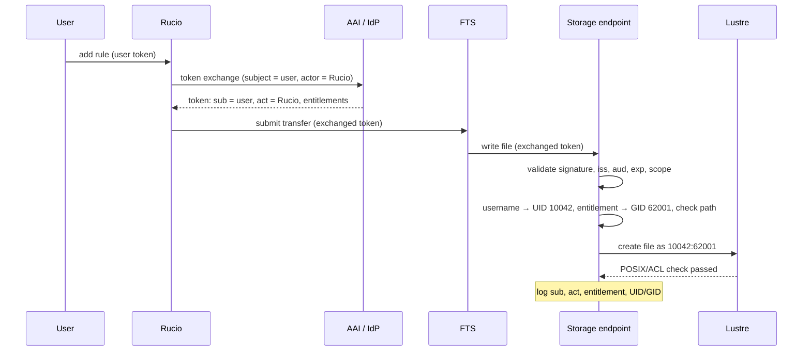
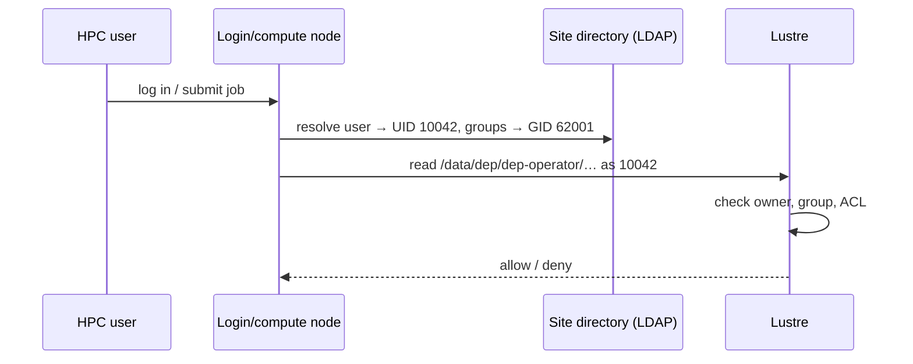

# Identity mapping on HPC storage

Concept behind [ADR-007](../adrs/adr-007-identity-mapping-on-hpc-storage.md).
Forward-looking: token exchange in Rucio is not available yet; until then
transfers run under Rucio's own identity (see "Interim" below).

Hard constraint: **user context is preserved end to end** and access is
fine-grained. Tokens carry *who* (user), *which groups and roles*
(entitlements) and *what executed it* (actor). POSIX storage like Lustre only
knows **numeric UIDs/GIDs**, so the storage endpoint translates the token
into a UID (user) and a GID (group) before any file is touched.

## Three questions, three claims

| Question | Claim | On storage | Used for |
| --- | --- | --- | --- |
| **Who** asked? | `sub` + username claim | file owner (UID) | attribution, quota, audit |
| **May** they access this? | `entitlements` | file group (GID), path rules | authorization |
| **What** executed it? | `act` | endpoint log only | chain of custody |

Access is decided **per group**, attribution is kept **per user**. Rucio
keeps one replica of a DID per RSE, and the project group lets every member
read it, so data registered once is stored once. Duplicates only arise when
the same content gets a second DID (see "One copy" below).

## What each layer looks like

**Token** after Rucio's token exchange (RFC 8693), decoded payload:

```json
{
  "iss": "https://aai.example.org/",
  "sub": "7f3c2a1e-…",
  "preferred_username": "alice",
  "act": { "sub": "rucio-dep" },
  "aud": "https://dep-teapot1.example:1094",
  "scope": "storage.read:/dep storage.modify:/dep",
  "entitlements": [
    "urn:example:aai.example.org:group:dep-operator:role=member"
  ],
  "exp": 1791205768
}
```

`sub` is opaque, so mapping to a site account uses a **stable, unique
username claim**. Entitlements follow the AARC-G002 pattern
`<namespace>:group:<group>[:<subgroup>]:role=<role>`.

**Endpoint mapping** (illustrative; syntax differs per storage type):

```
# username claim → local user (site directory resolves the UID)
alice                                                  → alice      (UID 10042)

# entitlement (group part)                  role       → local group, path, access
urn:example:aai.example.org:group:dep-operator  member → dep-operator (GID 62001), /data/dep/dep-operator, rw
urn:example:aai.example.org:group:project-x     member → projx        (GID 62002), /data/dep/project-x, r
```

Names map to **local** UIDs/GIDs, so every site keeps control of its own ID
space.

**Lustre**: owner is the user, group is the project; the setgid bit and a
default ACL make every new file belong to and be readable by the project:

```
$ ls -ln /data/dep/dep-operator/
-rw-rw---- 1 10042 62001 11 Oct  5 12:59 xrd-oidc-1791205168

$ getfacl /data/dep/dep-operator
# flags: -s-
user::rwx
group::rwx
user:deprucio:rwx          # Rucio service: deletion by the reaper
default:group::rwx
default:user:deprucio:rwx
other::---
```

## How access stays correct

- **Authorization by entitlement**: the endpoint checks the entitlement
  against the path; Lustre enforces the same through GID and ACL.
- **Attribution by user**: the file owner is the user; the endpoint logs
  `sub`, `act`, entitlement and mapped UID/GID for every request.
- **Writing as the user**: per-user ownership on disk needs an endpoint that
  writes as the mapped user (e.g. XRootD multiuser). Endpoints that write as
  their daemon user still enforce user and entitlement checks, but the on-disk
  owner is the daemon; attribution then lives in the endpoint log and Rucio.
- **Deletion**: the reaper deletes through the Rucio service account's
  directory ACL, whoever owns the file.
- **Cross-project data**: lives in one project's directory; other projects
  get an extra ACL entry, or Rucio places it in a shared area.
- **One copy**: deduplication is by DID, not by content. Shared data is
  registered once in a project scope (ADR-008); rules from several accounts
  on the same DID and RSE share one replica. Same content under another DID,
  files written outside Rucio, or a project re-uploading data it cannot read
  produce a second copy; a periodic catalog check on checksum and size
  finds these, and Rucio's auditor finds files unknown to Rucio.
- **Lifecycle**: removing an entitlement in the AAI revokes access with the
  next token; UIDs/GIDs come from the site directory and are never reused.
- **Interim**: until Rucio exchanges tokens, transfers carry Rucio's own
  token and are written as the Rucio service account; direct user access
  with personal tokens already follows this model.

## What changes, what doesn't

| Component | Change |
| --- | --- |
| AAI / IdP | Issues username and `entitlements` claims; supports token exchange with `act` |
| Rucio | **Development**: token exchange per user (`sub` = user, `act` = Rucio), refresh for queued transfers |
| FTS | Passes exchanged tokens to storage (verify support) |
| Storage endpoint | Username → UID and entitlement → GID/path mapping; writes as user; logs `sub`, `act`, entitlement |
| HPC site | User accounts and project groups in the site directory; setgid project directories with default ACLs |
| Lustre | None (POSIX + ACLs as today) |

## Runtime view

### Transfer on behalf of a user



### Direct access by a project member



## Open questions

See ADR-007. In short: Rucio token exchange design and timeline, FTS and
endpoint support for exchanged tokens and entitlement mapping per storage
type, which username claim is stable and unique, role → access-level policy,
account provisioning at HPC sites, cross-project data placement, endpoint log
retention, and token lifetime vs. queued transfers.
